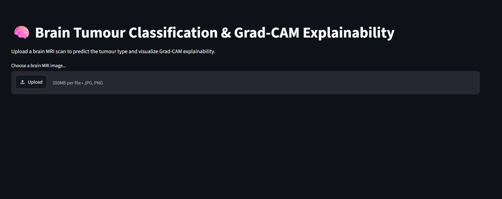
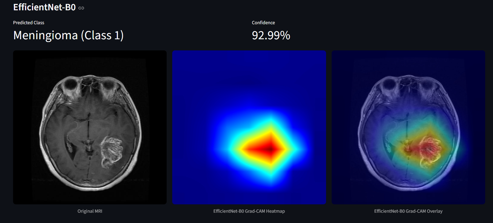
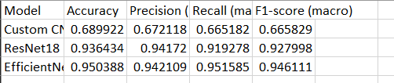

# Brain Tumour Classification & Explainability Using Grad-CAM

A deep learning project for classifying brain tumours from MRI scans using three different CNN-based architectures, with Grad-CAM visualizations to understand which image regions influence model predictions.

##  Live Demo

**Streamlit App:** [Try the live demo](https://tumorclassifer.streamlit.app)

##  Overview

This project uses deep learning to classify brain MRI images into three tumour categories:

- **Glioma**
- **Meningioma**
- **Pituitary Tumour**

Three models were trained and evaluated:

- Custom CNN
- ResNet18
- EfficientNet-B0

The application allows users to upload an MRI image, view predictions and confidence scores from all three models, and visualize model attention using Grad-CAM.

## Live Demo Preview

### MRI Prediction Interface

### Grad-CAM Visualization

## Implementation

**1. Exploratory Data Analysis (EDA)**
- Inspected MRI images and dataset structure.
- Analysed class distribution and image dimensions.
- Visualized sample images from each tumour category.

**2. Preprocessing**
- Extracted MRI images and labels from MATLAB `.mat` files.
- Resized images to 224 × 224.
- Normalized image pixel values.
- Applied data augmentation during training.

**3. Model Training**

Three architectures were implemented and evaluated:

- **Custom CNN:** A convolutional neural network built from scratch to establish a baseline.
- **ResNet18:** A pretrained residual network using transfer learning.
- **EfficientNet-B0:** A pretrained, computationally efficient architecture using transfer learning.

**4. Model Evaluation**

All three models were evaluated using accuracy, macro precision, macro recall, and macro F1-score.

EfficientNet-B0 achieved the highest test accuracy and macro F1-score among the three evaluated models.

## Explainability using Grad-CAM

Grad-CAM (Gradient-weighted Class Activation Mapping) is used to visualize image regions that contribute to a model's prediction.

It generates heatmaps and overlays them on the original MRI scans, helping visualize which regions influence the classification decision.

This provides a visual explanation of model behaviour, rather than treating predictions as black-box outputs.

## Tech Stack
- Python
- PyTorch
- NumPy
- Pandas
- Scikit-learn
- Matplotlib
- OpenCV
- Streamlit

